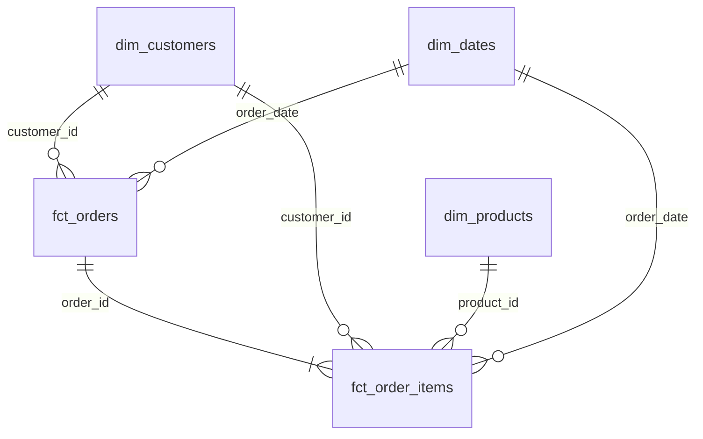
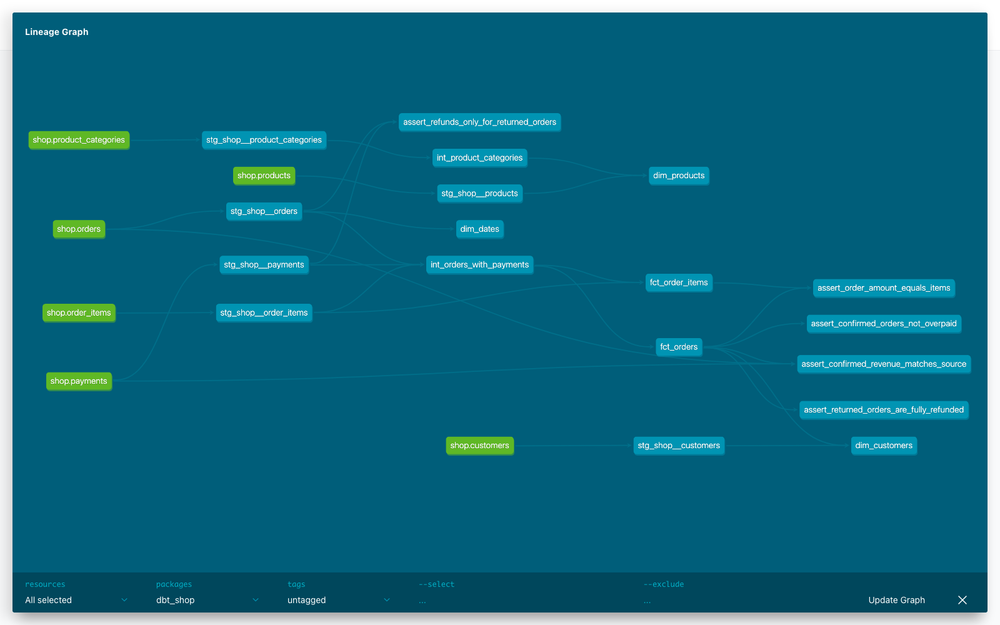

# Витрины интернет-магазина

Я построила аналитические витрины интернет-магазина в Greenplum с помощью dbt.

## Запуск

```bash
docker compose up -d
docker compose logs loader
docker compose build dbt
docker compose run --rm dbt deps
docker compose run --rm dbt build
```

## Модель данных



| Витрина | Зернистость | Бизнес-вопрос |
|---|---|---|
| `fct_orders` | Один заказ | Какая выручка и средний чек? |
| `fct_order_items` | Один товар в одном заказе | Какие товары и категории приносят выручку? |
| `dim_customers` | Один клиент | Сколько покупателей пришло из разных каналов? |
| `dim_products` | Один товар | К какой категории и бренду относится товар? |
| `dim_dates` | Один день | Как показатели меняются по датам? |

## Хранение в Greenplum

| Витрина | Хранение | Почему |
|---|---|---|
| `fct_orders` | `distributed by (order_id)` | Заказы соединяются с позициями по `order_id`. |
| `fct_order_items` | `distributed by (order_id)`, column | Одинаковый ключ ускоряет соединение с заказами. Таблица фактов хранится по колонкам. |
| `dim_customers` | `distributed replicated` | Маленькую таблицу можно скопировать на каждый сегмент. |
| `dim_products` | `distributed replicated` | Маленькую таблицу можно скопировать на каждый сегмент. |
| `dim_dates` | `distributed replicated` | Маленький календарь можно скопировать на каждый сегмент. |

Сырые `orders` и `order_items` тоже распределены по `order_id`. При соединении строки
не нужно пересылать между сегментами. Если выбрать разные ключи, пересылка понадобится.

## Дополнительное задание

Подключён пакет `dbt_utils`. В `dim_dates` макрос `date_spine` строит календарь от
первой до последней даты заказа.

## Найденная проблема в данных

Тест `assert_confirmed_orders_not_overpaid` имеет уровень `warn`. В заказе 113 сумма
равна 200, но есть два успешных списания по 200. Это ошибка в исходных данных.

## Lineage


